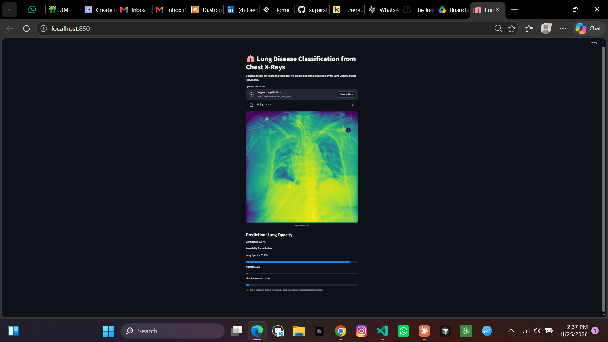

# Lung Disease Classification Using Chest X-Ray Images

A deep learning project that classifies chest X-ray images into three classes: **Normal**, **Lung Opacity** and **Viral Pneumonia**. It includes a Streamlit web app where a user can upload an X-ray and see the model's prediction.

Built for the 3MTT DeepTech_Ready Career Mentorship program.
Author: Muhammed-Raji Zainab Odunola

> ⚠️ This is a student learning project. It is **not** a medical diagnosis tool.



## Dataset
- **Lung X-Ray Image Dataset** from Mendeley Data: https://data.mendeley.com/datasets/p5rm59k7ph/1
- Originally sourced from Kaggle (https://www.kaggle.com/datasets/fatemehmehrparvar/lung-disease), licensed CC BY 4.0
- 3,475 images: Lung_Opacity (1,125), Normal (1,250), Viral Pneumonia (1,100)
- The dataset is not included in this repository. Download it from the link above.

## Method
1. **Data checks:** all images are 299×299 RGB; no corrupt files; 5 exact duplicate pairs found, all within the Viral Pneumonia class, and left in because their effect is negligible.
2. **Preprocessing:** images resized to 224×224 and scaled for MobileNetV2; 80/20 train/validation split with a fixed seed.
3. **Model:** transfer learning with **MobileNetV2** (pretrained on ImageNet, frozen) plus global average pooling, dropout (0.3) and a 3-class softmax layer. Data augmentation: small random rotation and zoom.
4. **Training:** Adam optimizer (learning rate 0.001), 5 epochs, on CPU.
5. **Fine-tuning experiment:** unfroze the last 30 layers of MobileNetV2 and trained 5 more epochs at a learning rate of 0.00001. It did **not** improve results (validation accuracy 0.89, and more Lung_Opacity images were missed), so the first model is the one used in the app.

## Results (validation set, 695 images)

| Class | Precision | Recall | F1-score |
|---|---|---|---|
| Lung_Opacity | 0.91 | 0.81 | 0.85 |
| Normal | 0.83 | 0.91 | 0.87 |
| Viral Pneumonia | 0.96 | 0.97 | 0.97 |

**Overall accuracy: about 90%**

## Limitations
The model separates Viral Pneumonia very well. Its main weakness is confusing **Lung_Opacity with Normal**: 41 of 216 Lung_Opacity validation images were predicted as Normal. In a medical setting, missing a disease is the costliest mistake, so improving Lung_Opacity recall is the main area for future work. High confidence scores in the app do not guarantee a correct prediction.

## Run the app locally
```
pip install -r requirements.txt
streamlit run app.py
```
Make sure `lung_model_v1.keras` is in the same folder as `app.py`.

## Files
- `Untitled1.ipynb`: data exploration, training and evaluation
- `app.py`: Streamlit web app
- `lung_model_v1.keras`: the trained model
- `requirements.txt`: Python libraries
- `app_screenshot.png.png`: screenshot of the app

## Future improvements
- Train for more epochs and try larger models
- Use class weights or more data to improve Lung_Opacity recall
- Check for near-duplicate images
- Test on an independent dataset
